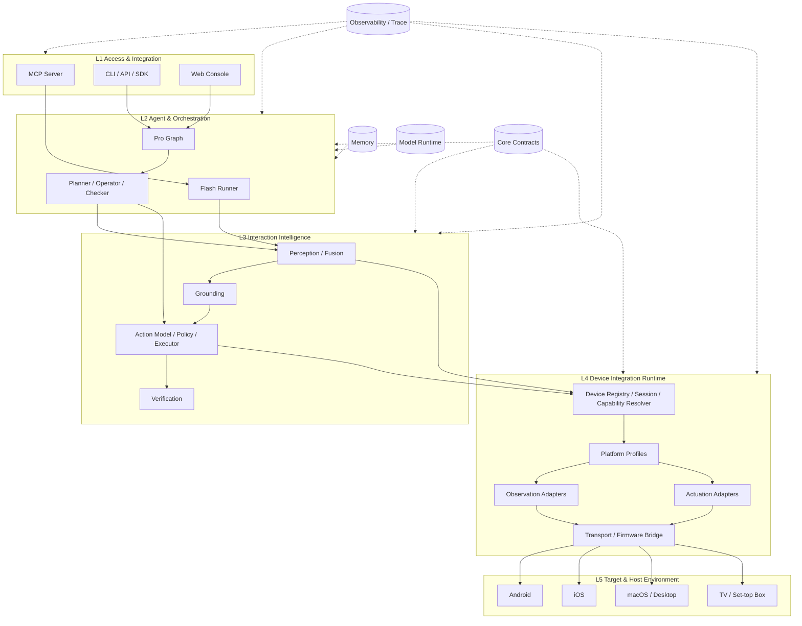

# ARTEMIS 通用硬件操控 Agent 架构改造执行计划

> 文档类型：架构演进与实施计划（Migration Plan）  
> 目标：先将原始 ARTEMIS 的 Agent Runtime 与 Android 设备实现解耦，形成通用硬件操控 Agent Core；再通过可组合 Adapter / Platform Profile 接入 iOS、macOS、TV 等环境。  
> 执行原则：先盘点、先契约、先重构核心、再接入新平台；渐进迁移，不推倒重写。  
> 配套规范：`ARCHITECTURE_CONTRACT.md`；Coding Agent 规则：仓库根目录 `AGENTS.md`。

---

## 0. 目标、范围与关键决策

### 0.1 目标不是“给 Android Agent 加一个 iOS Adapter”

本次工程目标是把 ARTEMIS 从 Android 优先的移动 UI 自动化工程，演进成**可组合设备观察与控制能力的通用 Agent 平台**：

- Agent Core：理解任务、计划、决策、检查和总结，不感知设备品牌/OS/协议；
- Interaction Intelligence：理解各种设备的观察结果，完成目标定位、动作语义化、策略校验、执行编排与结果验证；
- Device Integration Runtime：发现设备、建立 Session、解析 Capability、组合 Observation / Actuation / Transport Adapter；
- Platform Profiles：通过组合能力接入 Android、iOS、macOS、TV 等目标系统；
- Hardware/Firmware：作为 L4 的设备集成实现独立构建，不承载 Agent 业务逻辑。

### 0.2 第一阶段范围

第一阶段聚焦**可观察、可交互的数字设备**，例如手机、平板、桌面系统、电视和机顶盒。通用架构允许添加新的传感器与执行器，但不等于可直接用于工业控制、机器人、车辆、医疗或其他安全关键物理系统。

### 0.3 核心决策

1. 保留现有 `artemis` Python 包名、CLI/MCP/SDK 的公共入口，除非必要且经过版本化迁移。
2. 保留 Flash / Pro 的核心行为，将其从 Android 的具体控制实现中解耦。
3. 不把 iOS、Android、macOS、TV 做成四套 Agent；统一 Agent Runtime + 不同 Profile。
4. 可复用能力优先抽为 Adapter：例如 UVC、USB Serial、ESP32 HID、ADB、ScreenCaptureKit、Accessibility、HDMI Capture、CEC、IR。
5. Platform Profile 负责组合 Adapter、声明能力和权限，不放 Prompt、Planner 或任务工作流。
6. 先以 Mock 验证抽象，再迁移 Android 现有实现作为兼容性参考，随后接入新平台。
7. 第一版插件机制采用显式注册/依赖注入，不急于建设动态插件市场或任意第三方代码加载。
8. 设备操作结果、系统输入接受、界面变化和任务目标完成必须分层表达。

### 0.4 对当前原始仓库的基线认知

当前 Google ARTEMIS README 仍将项目描述为 Android 自动化，依赖 ADB 与 Accessibility Helper / UIAutomator2，提供 Flash 与 Pro 两种执行 Profile，以及 CLI、MCP、Web Console、Python SDK 和 Trace/Replay 能力；README 将 iOS 平台扩展列为后续方向。`pyproject.toml` 中 CLI 入口为 `artemis.interfaces.cli.main:cli`，Admin 入口为 `apps.admin_console.server:main`；MCP Server 文档说明 `mcp_server/` 通过后台任务运行 Agent，并与 `artemis/runtime/trace_store.py` 等状态存储协作。

因此，本计划不是声称上游已经具备通用多平台能力，而是定义一个面向用户目标的架构演进方向。执行时必须基于所使用分支的实际代码重新盘点，不得把本文件中的目标目录误认为当前目录。

参考：
- https://github.com/google/artemis
- https://github.com/google/artemis/blob/main/README.md
- https://github.com/google/artemis/blob/main/pyproject.toml
- https://github.com/google/artemis/blob/main/mcp_server/README.md

---

## 1. 目标架构

### 1.1 五层运行架构

| 层 | 名称 | 核心职责 | 不应承担的职责 |
|---|---|---|---|
| L1 | Access & Integration | MCP、CLI、API、SDK、Web Console、IDE 接入 | 设备驱动、视觉判断、Agent 推理 |
| L2 | Agent & Orchestration | Planner、Operator、Checker、Flash/Pro、Graph、任务生命周期 | OS 判断、协议编码、硬件连接 |
| L3 | Interaction Intelligence | Perception、Grounding、标准动作、策略、执行编排、Verification | 打开设备、操作底层 Transport、拼固件 Report |
| L4 | Device Integration Runtime | Device Registry/Session、Capability、Adapters、Profiles、Transport、Firmware Bridge | 业务任务规划、Prompt、用户目标推理 |
| L5 | Target & Host Environment | Android/iOS/macOS/Windows/Linux/TV OS、App、系统服务、硬件行为 | 不属于 ARTEMIS 代码层 |

### 1.2 横向基础设施

Core Contracts、Model Runtime、Memory、Observability/Data Engine、Config 横向服务于多个层，不强制归入某一层。

### 1.3 目标模块关系



### 1.4 Adapter 与 Profile 的分工

**Adapter 是可复用的能力实现**，例如：

- Observation：ADB screenshot、scrcpy frame、UVC camera、ScreenCaptureKit、HDMI capture、Accessibility API；
- Actuation：ADB input、native desktop input、USB HID、ESP32 HID bridge、TV remote、HDMI-CEC、IR；
- Transport：USB、Serial/CDC、BLE、TCP/IP、厂商网络接口。

**Platform Profile 是能力组合**，例如：

- Android Profile：Accessibility Helper/UIAutomator2 + ADB/scrcpy + Android input；
- iOS Profile：UVC Observation + ESP32 HID Bridge（仅将实测能力标记为 verified）；
- macOS Profile：ScreenCaptureKit + Accessibility API + 原生键鼠输入；
- TV Profile：HDMI/系统状态观察 + CEC/IR/Bluetooth/网络遥控协议。

同一 Adapter 可被多个 Profile 复用；一个 Profile 也可以组合多个 Observation 和 Actuation Adapter。不得将 `UVC` 设计成 iOS 专属技术，也不得将 `ESP32 HID` 写成 iOS 的一部分。

---

## 2. 目标目录结构

先保持现有仓库的包名和发布入口，目标结构可以逐步演进为：

```text
repo-root/
├── AGENTS.md
├── artemis/
│   ├── interfaces/                     # L1
│   ├── agents/                         # L2
│   ├── orchestration/                  # L2：Flash / Pro / Graph / Task Flow
│   │
│   ├── interaction/                    # L3
│   │   ├── perception/
│   │   │   ├── image/
│   │   │   ├── video/
│   │   │   ├── ocr/
│   │   │   ├── accessibility/
│   │   │   ├── window_tree/
│   │   │   └── fusion/
│   │   ├── grounding/
│   │   ├── actions/
│   │   │   ├── intents/
│   │   │   ├── planning/
│   │   │   ├── policy/
│   │   │   └── execution/
│   │   ├── verification/
│   │   └── tools/                       # Agent-facing tool facade
│   │
│   ├── device_runtime/                  # L4：Registry / Session / Capability
│   │   ├── registry/
│   │   ├── discovery/
│   │   ├── sessions/
│   │   ├── capabilities/
│   │   └── health/
│   │
│   ├── adapters/                        # L4：可复用适配器
│   │   ├── observation/
│   │   │   ├── adb/
│   │   │   ├── scrcpy/
│   │   │   ├── uvc/
│   │   │   ├── screen_capture_kit/
│   │   │   ├── hdmi_capture/
│   │   │   └── accessibility/
│   │   ├── actuation/
│   │   │   ├── adb_input/
│   │   │   ├── native_desktop_input/
│   │   │   ├── hid/
│   │   │   ├── tv_remote/
│   │   │   ├── hdmi_cec/
│   │   │   └── infrared/
│   │   ├── transport/
│   │   │   ├── usb/
│   │   │   ├── serial/
│   │   │   ├── bluetooth/
│   │   │   └── network/
│   │   └── platforms/
│   │       ├── android/
│   │       ├── ios/
│   │       ├── macos/
│   │       └── tv/
│   │
│   ├── core/contracts/                  # 横向 Ports / DTO / Errors
│   ├── model_runtime/                   # 横向 Model Provider / Routing
│   ├── memory/                          # 横向 Agent Context / Retrieval
│   ├── observability/                   # 横向 Trace / Events / Replay
│   ├── config/                          # 横向 Config Schema / Loader
│   └── utils/                           # 只保留真正通用工具
│
├── firmware/esp32/                      # 独立构建的 ESP32 固件
│   ├── protocol/
│   ├── hid_descriptors/
│   ├── hid_reports/
│   ├── safety/
│   └── tests/
│
├── mcp_server/                          # L1
├── apps/                                # L1 Web/Admin
├── packages/                            # L1 SDK
├── third_party/                         # 上游代码及 License
└── tests/
    ├── architecture/
    ├── contract/
    ├── adapters/
    ├── integration/
    ├── platforms/
    └── hardware/
```

目录名可按现有项目风格调整，但职责边界必须遵守 `ARCHITECTURE_CONTRACT.md`。

---

## 3. 迁移总原则

- **先重构核心，再接入新平台。** 不以先写 iOS 特例来倒逼 Agent 核心；先建立通用 Device Runtime 和 Ports。
- **Android 作为兼容参考平台。** 在新架构中保留其原有能力和可回归任务，避免抽象只适配 iOS。
- **不一次性搬目录。** 每个 PR 改一个主要边界，确保可独立测试、可回滚。
- **先抽象重复变化点，不抽象臆想场景。** 不为了未来未知硬件建立复杂框架。
- **先静态注册，再考虑动态插件。** 第一版本用 Registry + Dependency Injection；稳定后才考虑 Python entry points 或第三方插件分发。
- **兼容优先。** 通过 Facade/Re-export 保留旧 import、旧 Tool 和公共 API，待调用方迁移完再删除。
- **设备能力证据驱动。** Profile 里的能力不能仅凭硬件规格或协议文档标为 verified。
- **每一个动作必须可解释。** 记录目标、能力选择、动作参数、Adapter、回执和后续验证证据。

---

## 4. 分阶段执行计划

每阶段可拆为多个 PR。阶段 Exit Criteria 未达到时，不进入依赖它的下一阶段。

### Phase 0 — 原工程盘点与基线冻结

**目的：** 确认实际代码和当前运行行为，避免按推测搬迁。

工作项：

- [ ] 导出仓库目录树，排除 `.venv`、cache、build、dist、生成文件和第三方大目录；
- [ ] 确认 CLI、MCP、API、Web Console、SDK 的入口与真实调用路径；
- [ ] 追踪 Flash、Pro 的完整状态流和 Tool 调用链；
- [ ] 追踪当前 Android 设备发现、会话、截图、Hierarchy、动作执行和权限检查；
- [ ] 追踪 Explorer、Validator、Checker、Summarizer、Memory、Trace 的真实职责；
- [ ] 生成 Python import graph、模块依赖矩阵、潜在循环依赖清单；
- [ ] 标记 `artemis/mcp`、`controllers`、`drivers`、`runtime`、`tools` 中跨职责文件；
- [ ] 建立至少一条 Flash 和一条 Pro Android 回归任务；
- [ ] 保存现状截图/Trace/测试结果和性能基线；
- [ ] 盘点当前公开导入路径、CLI 参数、MCP Tool Schema、配置项和 SDK 语义。

交付物：

- `docs/architecture/BASELINE_INVENTORY.md`
- `docs/architecture/CURRENT_CALL_FLOWS.md`
- `docs/architecture/DEPENDENCY_MATRIX.md`
- `docs/architecture/COMPATIBILITY_BASELINE.md`

Exit Criteria：

- 真实入口、主要调用链、关键依赖均有源码位置和测试证据；
- Android 的关键 Flash/Pro 任务可以复现；
- 已知架构边界和风险有清单；
- 本阶段不做大规模代码迁移。

### Phase 1 — 定义通用 Domain Model 与 Ports

**目的：** 定义任何平台都能实现的最小设备抽象，不实现具体 Adapter。

工作项：

- [ ] 定义 `DeviceDescriptor`、`ControlTarget`、`PlatformProfile`、`DeviceSessionSpec`；
- [ ] 定义 `CapabilitySet`，区分 supported / available / verified / unknown；
- [ ] 定义 `ObservationRequest`、`ObservationSample`、`PerceivedState`、`GroundedTarget`；
- [ ] 定义 `ActionIntent`、`ActionCommand`、`ActionReceipt`、`VerificationResult`；
- [ ] 定义 `ObservationPort`、`ActuationPort`、`DeviceProvider`、`DiagnosticPort`；
- [ ] 定义错误码、session/action/trace ID、状态新鲜度和时间戳规则；
- [ ] 定义坐标空间和 `CoordinateTransform`；
- [ ] 写 Mock Provider/Observation/Actuation Adapter；
- [ ] 写 Port Contract Tests；
- [ ] 新建 ADR：通用设备模型、动作语义、能力状态、插件注册策略。

建议交付目录：`artemis/core/contracts/`。

Exit Criteria：

- 不导入任何 Android/iOS/USB/ADB 库即可使用核心 DTO 和 Port；
- Mock 设备可以发现、建立 Session、查询能力、观察、执行和关闭；
- Agent 和 Interaction Intelligence 的类型定义不出现平台专有字段作为必填项。

### Phase 2 — 建立 Device Integration Runtime

**目的：** 建立多设备、多 Adapter、多 Profile 的运行时骨架。

工作项：

- [ ] 实现 Device Registry 和 Provider Registry；
- [ ] 实现 Adapter Registry / 显式注册机制；
- [ ] 实现 Platform Profile Loader 和 Profile Validator；
- [ ] 实现 Capability Resolver：根据 Device + Profile + 权限 + Adapter Health 计算当前能力；
- [ ] 实现 Device Session 生命周期：discover → connect/open → ready → degraded/reconnecting → closing → closed；
- [ ] 实现资源租约、设备锁、超时、取消、幂等 close 和 release_all；
- [ ] 支持一台 Device 组合多个 ObservationPort 和 ActuationPort；
- [ ] 加入 Mock Profile 和多设备并发测试；
- [ ] 在启动 Composition Root 完成 Adapter 装配，禁止 Agent 自行 import Adapter。

Exit Criteria：

- Runtime 可只依赖 Core Contracts 管理 Mock 设备；
- 多设备并行与单设备互斥策略可测；
- Profile 可以表达 capability 缺失和权限不足；
- 设备断开/重连不会复用旧 session 的定位或动作。

### Phase 3 — 重构 L3：将设备控制细节从交互智能中剥离

**目的：** 先把 ARTEMIS 的感知/动作业务逻辑变成平台无关能力。

工作项：

- [ ] 将原始截图、UI Tree、日志等数据统一映射为 ObservationSample；
- [ ] 将图像/视频、OCR、UI Tree、窗口信息的处理归入 Perception Pipeline；
- [ ] 将 Explorer 的 Agent 推理留在 L2，把可复用图像预处理、Grounding、候选框解析迁入 L3；
- [ ] 定义 PerceivedState 和 GroundedTarget，元素索引必须绑定 state_revision；
- [ ] 将语义动作和设备命令拆开：Agent 产生 ActionIntent，L3 生成 ActionCommand；
- [ ] 将动作前置检查、安全策略、Burst、Incident、重试协调归入 L3；
- [ ] 将 Checker 的任务验收与动作前置条件分离；
- [ ] 将动作后观察和目标 Verification 统一为证据驱动流程；
- [ ] 将 L3 所有设备操作改成通过 Ports 调用；
- [ ] 保留现有 Tool 名称作为 Facade，逐步转发到新能力服务。

Exit Criteria：

- L3 测试可以使用 Mock Observation/Actuation Port；
- Perception 不直接打开设备，Action Engine 不直接操作 ADB/USB/Serial；
- Explorer/Operator 不保存设备私有句柄；
- 一个相同的 ActionIntent 可由不同 Profile 按 capability 执行，或明确返回不支持。

### Phase 4 — 重构 L2：保持 Agent 核心，去除平台耦合

**目的：** 将 Flash / Pro / Agent Role 从 Android 细节中解耦，而不是重写其推理逻辑。

工作项：

- [ ] 盘点 Planner、Operator、Checker、Summarizer、Diagnoser 的输入输出，改用平台无关状态和 Capability View；
- [ ] 保留 Flash 的快速 Observe-Think-Act Loop；
- [ ] 保留 Pro 的 Planner/Operator/Checker Graph、checkpoint 和 incident feedback；
- [ ] 将 Agent 可调用的 Tool 设计成稳定能力门面，不直接暴露 `adb.*`、`serial.*` 或 `hid_report.*`；
- [ ] 移除 Agent Prompt 中对具体 OS、驱动和硬件协议的假设；
- [ ] 使用 Device Capability Summary 告诉 Agent 当前可用动作，不让 Agent自行猜测；
- [ ] 把平台专属策略下沉到 Profile / Adapter；
- [ ] 回归任务计划、Memory、历史召回和 Trace 关联。

Exit Criteria：

- Agent Core 在不连接 Android 设备时可通过 Mock 执行完整任务循环；
- 同一 Agent 可针对不同 Profile 获取不同能力说明，但无需平台 if/else；
- Flash / Pro 原有 Android 任务行为没有不可解释的回归。

### Phase 5 — 把现有 Android 实现迁为第一个 Platform Profile

**目的：** 用已有 Android 功能证明通用抽象不是只适合新设备。

工作项：

- [ ] 将现有 Android 设备发现与连接封装为 Android DeviceProvider；
- [ ] 将 ADB 截图、scrcpy 或现有屏幕来源包装为 Observation Adapter；
- [ ] 将 Accessibility Helper / UIAutomator2 包装为独立语义树 Observation Adapter；
- [ ] 将 ADB input 等控制能力包装为 Actuation Adapter；
- [ ] 以 Android Profile 组合上述 Adapter 并声明权限、能力、优先级和 fallback；
- [ ] 迁移原有 controller/driver 到新 Port 实现；
- [ ] 旧 `controllers`、`drivers`、`mcp`、`runtime` 路径暂时保留 Facade/Re-export；
- [ ] 重跑现有 Flash/Pro、AndroidWorld 子集和多设备并发回归；
- [ ] 对比新旧架构的成功率、时延、模型调用数和资源占用。

Exit Criteria：

- Android 是通过 Device Runtime + Profile 接入，不是 Agent 的特例；
- 既有 CLI/MCP/SDK/UI 的主要用法兼容；
- 回归指标达到 Phase 0 设定阈值；
- 旧路径迁移清单和删除条件明确。

### Phase 6 — 建立通用硬件 Adapter 与 Firmware Bridge

**目的：** 将 UVC、USB Serial、ESP32 HID 等做成可复用的 L4 能力，而不是 iOS 专用功能。

工作项：

- [ ] 定义 Host-Firmware Protocol（版本、session、seq/command_id、deadline、ACK 阶段、错误码）；
- [ ] 实现通用 USB/Serial Transport Port 和 Host Adapter；
- [ ] 把 ESP32 TinyUSB 固件作为独立工程，明确其 USB Descriptor、HID Report 和控制接口；
- [ ] 固件实现输入状态机、release_all、watchdog、断连恢复和重复命令处理；
- [ ] 实现通用 HID Actuation Adapter，区分 Pointer、Keyboard、Digitizer/Touch 等语义和能力；
- [ ] 实现 UVC Observation Adapter，只负责枚举、打开、采集、时间戳、基本解码和释放资源；
- [ ] 将去畸变、透视校正、图像裁切、OCR、Grounding 放在 L3；
- [ ] 为协议建立 Host 单元测试、Firmware Parser 测试和硬件在环测试；
- [ ] 发布固件版本、协议版本及兼容矩阵。

Exit Criteria：

- UVC 和 ESP32 HID 可分别被 Mock/测试程序使用，不依赖 iOS Profile；
- 固件 ACK 语义不被误解为目标 OS/App 已响应；
- 断连、超时、异常退出会安全释放输入状态；
- 固件可独立构建、刷写、诊断和回滚。

### Phase 7 — 用组合 Adapter 接入 iOS

**目的：** 作为第一个非 Android 平台验证通用架构。

工作项：

- [ ] 新建 iOS Platform Profile，不改 Agent Core；
- [ ] Observation 组合 UVC Adapter；若未来采用其他采集方案，可通过 Profile 替换；
- [ ] Actuation 组合 ESP32 HID Adapter；Host-Firmware Transport 与 HID Report 分层；
- [ ] 实现设备能力握手和真实验证记录；
- [ ] 建立 UVC Frame → Display/Screen 坐标的 Calibration/Transform；
- [ ] 验证 iPhone/iOS 具体版本对 Mouse、Keyboard、Digitizer/Touch Report 的真实行为；
- [ ] 明确 AssistiveTouch、权限、外接转接器、USB Suspend/Resume 等限制；
- [ ] 实现断连/重连、坐标失效、设备方向变化和异常释放测试；
- [ ] 使用同一 Agent 完成打开 App、查找目标、执行交互、观察并验证的端到端任务。

Exit Criteria：

- iOS 特殊逻辑集中在 Profile/Adapter，不出现 Operator 的 iOS 分支；
- 未实测能力标记为 unknown/advertised，不宣称已支持；
- 至少完成一条真实 iPhone 端到端闭环，并有 Trace 和测试记录；
- iOS Profile 的限制和已验证设备矩阵明确。

### Phase 8 — 接入 macOS 与 TV，验证架构可组合性

**目的：** 证明通用能力不是“Android + iOS 双手机架构”。这两个平台可以分批，不要求同一迭代全部完成。

#### macOS Profile

- [ ] 观察：ScreenCaptureKit/系统截图、Accessibility API、窗口/Display 信息；
- [ ] 控制：原生键盘/鼠标事件、窗口/应用操作（仅限实际权限允许的能力）；
- [ ] 实现 Screen Recording、Accessibility、Input Monitoring 等授权诊断；
- [ ] 处理多显示器、Retina scale、窗口局部坐标和焦点变化；
- [ ] 验证应用启动、窗口切换、文本输入、菜单操作等任务。

#### TV Profile

- [ ] 根据设备选择观察源：HDMI Capture、系统 API、ADB、厂商接口或视觉采集；
- [ ] 根据设备选择执行器：Remote Key、Bluetooth Remote、HDMI-CEC、IR、ADB 或网络 API；
- [ ] 定义焦点导航、方向键、确认、返回、Home、媒体控制等语义动作；
- [ ] 不假设 TV 有 Accessibility Tree、精确触控或可写文字输入；
- [ ] 处理输入源、待机/唤醒、配对、CEC/IR 不可靠回执等情况。

Exit Criteria：

- macOS/TV 无需新增 Agent 专属分支；
- 通过新增/组合 Adapter 和 Profile 暴露能力；
- 不同 Profile 的缺失能力和权限状态可被 Agent 正确理解；
- 共享 Agent Core 的端到端测试至少在两个不同交互范式上通过（例如触屏/桌面/遥控器导航）。

### Phase 9 — 架构治理、发布和旧代码收敛

工作项：

- [ ] 建立 Import Boundary Tests，强制依赖方向；
- [ ] 建立 Adapter Contract Test Template；
- [ ] 建立 Profile Manifest Schema 和能力验证报告；
- [ ] 建立模拟设备、测试数据、录屏/Trace 回放基线；
- [ ] 统一错误码、事件命名、session/action/trace 关联 ID；
- [ ] 补充设备权限诊断、Adapter health 和 Profile compatibility 命令；
- [ ] 对旧路径统计调用方，全部迁移后才删除兼容 Facade；
- [ ] 更新架构图、开发指南、平台接入指南和 ADR 索引；
- [ ] 发布版本兼容策略、固件兼容矩阵和 Platform Profile 支持矩阵。

最终退出条件：

- 核心 Agent 与具体设备依赖隔离；
- 设备平台通过 Registry/Profile/Adapter 接入；
- 每个 Adapter 有契约测试，每个 Profile 有真实环境验证记录；
- 架构规则进入 CI；
- 现有 Android 工作流保留且可回归；
- iOS/macOS/TV 的实现状态与已知限制透明。

---

## 5. 建议 PR 拆分和实施顺序

| PR | 内容 | 主要交付 | 是否搬迁大量代码 |
|---|---|---|---|
| PR-0 | Baseline Inventory | 调用链、目录、依赖、回归基线 | 否 |
| PR-1 | Core Contracts | DTO、Ports、Capabilities、Errors | 否 |
| PR-2 | Device Runtime Skeleton | Registry、Session、Profile、Mock | 少量新代码 |
| PR-3 | L3 Interaction Boundary | Observation/Action/Verification 门面 | 局部抽离 |
| PR-4 | L2 Agent Decoupling | Flash/Pro 使用通用 Interaction API | 局部修改 |
| PR-5 | Android Compatibility Profile | 现有 Android 适配新 Port | 中等迁移，保留兼容层 |
| PR-6 | Generic UVC + HID + Firmware Bridge | 通用硬件 Adapter 和独立固件 | 新增为主 |
| PR-7 | iOS Profile | UVC + ESP32 HID 组合与真机验证 | 新增为主 |
| PR-8 | macOS Profile | 原生观察/输入 Adapter | 新增为主 |
| PR-9 | TV Profile | HDMI/CEC/IR/ADB/Remote 组合 | 新增为主 |
| PR-10 | CI / Cleanup | 架构测试、旧路径清理、文档 | 清理为主 |

每个 PR 必须：范围单一、可独立运行测试、有改动说明和回滚方法。不得将 Phase 0～5 与首个 iOS 真机实现合并成一个大 PR。

---

## 6. 自动化架构检查

至少建立以下 CI 检查：

1. **Import Boundary**：Agent 不可 import Adapters；L3 不可 import L4 具体实现；Adapter 不可 import Agent/Graph/MCP Server；Core Contracts 不可 import业务实现。
2. **Port Contract**：每个 Adapter 运行通用契约测试。
3. **Profile Validation**：Profile 引用的 Adapter 存在；能力声明结构有效；未验证能力不能标 verified。
4. **API Compatibility**：CLI、MCP Tool Schema、SDK 公共入口的兼容测试。
5. **Session Lifecycle**：open/close/cancel/reconnect/release_all 和多设备并发测试。
6. **Action Semantics**：不支持动作必须显式失败；禁止无策略静默降级；非幂等命令禁止盲目重试。
7. **Trace Correlation**：设备动作、Observation、Incident、Verification 关联同一个 session/task/trace。
8. **Firmware Protocol**：Host/Firmware 协议兼容测试和版本协商测试。

架构测试只在模块边界和 import 方向上做约束，不应过早把每个内部函数、目录名或实现细节锁死。

---

## 7. 关键风险与控制措施

| 风险 | 影响 | 控制措施 |
|---|---|---|
| 过度抽象 | 首期复杂度过高、交付变慢 | 先支持数字交互设备；显式注册；只抽象已出现的变化点 |
| 把平台能力强行统一 | 最弱公分母、语义失真 | Action Intent 与 CapabilitySet；不支持就明确拒绝 |
| 迁移破坏 Android | 现有能力回退 | Android 作为第一兼容 Profile；保留原有任务回归和兼容 Facade |
| Agent 仍然写平台分支 | 核心逐渐重新耦合 | Import Boundary + Prompt review + Capability 驱动 |
| Adapter/Profile 混淆 | 平台代码重复 | 可复用机制进入 Adapter，平台只负责组合与差异配置 |
| ACK 语义不清 | 把执行误判为成功 | Action Receipt 与 Verification 分离 |
| 坐标体系混乱 | 点击偏移、误操作 | 显式 CoordinateSpace、Transform ID、标定失效机制 |
| 断连时输入保持 | 鼠标/键盘/触点卡住 | release_all、watchdog、幂等清理和硬件测试 |
| 插件机制过早动态化 | 调试困难、安全风险 | 首期显式注册和本地可信插件，稳定后再扩展加载机制 |
| 扩展到安全关键硬件 | 人身/财产风险 | 独立安全评审和专用控制系统，不复用 UI Agent 默认策略直接控制 |

---

## 8. 建议交付物清单

### 架构治理

- `docs/architecture/ARCHITECTURE_CONTRACT.md`
- `docs/architecture/REFACTOR_EXECUTION_PLAN.md`
- `docs/architecture/decisions/ADR-0001-general-device-domain.md`
- `docs/architecture/decisions/ADR-0002-capability-and-profile.md`
- `docs/architecture/decisions/ADR-0003-observation-and-action-ports.md`

### Phase 0 盘点

- `BASELINE_INVENTORY.md`
- `CURRENT_CALL_FLOWS.md`
- `DEPENDENCY_MATRIX.md`
- `COMPATIBILITY_BASELINE.md`

### 核心契约

- Device / Target / Session / Platform Profile DTO；
- Observation / Perceived State / Grounded Target DTO；
- Action Intent / Command / Receipt / Verification DTO；
- Capability Manifest Schema；
- Port Contract Tests。

### 平台接入

- Android Profile（兼容基线）；
- iOS Profile + UVC Adapter + ESP32 HID Bridge；
- macOS Profile；
- TV Profile；
- 各 Profile 的权限、能力状态、真实设备验证和已知限制报告。

---

## 9. 执行启动指令（给 Coding Agent）

第一轮不要写代码，不要移动文件。先执行 Phase 0：

1. 扫描当前仓库真实结构；
2. 追踪 L1 → L2 → L3 → 现有 Android Driver 的真实调用链；
3. 识别当前 `agents`、`graph`、`mcp`、`tools`、`controllers`、`drivers`、`runtime`、`memory`、Trace/Data Engine 的职责与 import；
4. 输出四份 Baseline 文档；
5. 对照 `ARCHITECTURE_CONTRACT.md` 给出差距矩阵；
6. 给出 PR-1 的最小实施方案和风险。

未经用户确认 Phase 0 结果，不要直接开始大规模搬迁。后续每个 PR 完成后，必须给出测试结果、兼容性说明、未验证事项和回滚方案。
